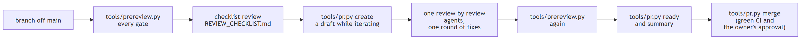
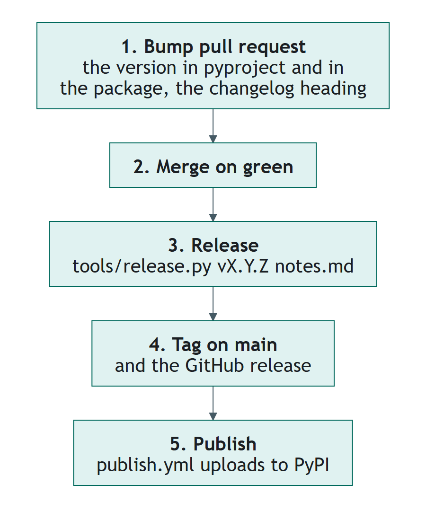

# Contributing

Other groups load these packages in their experiments, so the rules keep their numbers stable. Every
rule is a command you can run.

The repository holds two toolkits, and every rule below covers both. The generation toolkit is the
distribution `fdia-graph`, the package `fdia_graph` under `src/`, with its tests in `tests/`: it
generates a timeline and loads it. The analysis toolkit is the distribution `fdia-analysis`, the
package `fdia_analysis` under `analysis/src/`, with its tests in `analysis/tests/` and its own
`analysis/pyproject.toml`: state estimation, localization, federated training, trusted-meter selection
and the results store's code. The dependency points one way: `fdia_analysis` imports `fdia_graph`,
and nothing in `fdia_graph` imports `fdia_analysis` (`tests/test_toolkit_boundary.py`). A model or a
formula the generator or the loader uses lives in `fdia_graph` (`models/`, `formulas/`); one only
the analysis packages use lives in `fdia_analysis`; no name is exported by both.

## Setup

```bash
git clone https://github.com/myersben9/fdia-graph
cd fdia-graph
pip install -e ".[generate,torch,dev]" -e "./analysis[se,federated]"   # both toolkits, from this checkout
pytest -n auto                                # both suites (tests, analysis/tests) in parallel (pytest-xdist,
                                              # in the dev and test extras); each worker builds its own tiny
                                              # timeline and pool download. Always from the repository root:
                                              # its conftest.py holds the fixtures of both suites
```

`docs/concepts/flow.md` is the map and the reading order; `docs/reference/MODULES.md` says what every
file does.

Every diagram is a rendered image, never a Mermaid block: the README is also the PyPI page, and the
docs are read in the GitHub mobile app, and neither renders Mermaid. Each diagram's source is a
`docs/figures/diagrams/<name>.mmd` next to its `<name>.png` and `<name>.svg`; edit the source and
re-render with `python tools/render_mermaid.py docs/figures/diagrams/<name>.mmd` (Playwright with
Chromium), which writes both images, then commit all three. A hand-written flow diagram is drawn for
a phone: the renderer uses 20 px type and the site's teal palette, and puts the diagram at its natural
size on a white card 450 px wide with rounded corners, so the PNG (two device pixels per CSS pixel) is
900 px wide and reads on a dark page and on a light one. `python tools/prereview.py` fails a
hand-written flow diagram that is not `flowchart TB`, has more than 8 nodes or has a PNG wider than
900 px, or names a node otherwise than `name["label"]`; the diagrams not yet redrawn are listed in
`NOT_YET_REDRAWN` in `tools/prereview.py`. On the docs site `docs/stylesheets/extra.css` shows a phone
diagram at most 450 px wide, and names the same exempt diagrams. The class
and module diagrams of `docs/reference/CLASS_MAP.md` are generated: `python tools/class_diagrams.py`
rewrites their sources from the code (CI fails when they are stale), then render them the same way;
the renderer knows them by name (`classes_*`, `modules`), keeps them wide (Mermaid's default theme on
a 1400 px page) and the gate exempts them. README images use the
raw.githubusercontent.com URL so PyPI shows them; docs pages use relative paths.

The Models section of `docs/reference/DATA_DICTIONARY.md` is generated too: `python tools/models_doc.py`
rewrites it from the dataclasses in the two `models/` packages (`src/fdia_graph/models/`,
`analysis/src/fdia_analysis/models/`) and the comment beside each field. Edit
the comment in the source, never the section, and rerun the tool; the tests fail when it is stale.

The docs site is built from `docs/` plus the three root pages by `mkdocs.yml`: the Vercel build serves
the main branch at the custom domain, and `.github/workflows/docs.yml` deploys one copy per package
version to GitHub Pages with mike (a tag push deploys that version as `latest`, a push to main
deploys `dev`), so every release's docs stay readable after the next release; the version picker on
each page switches between them. `python tools/site_index.py && python -m mkdocs build --strict`
checks a docs change locally.

The pages are sorted by kind, one folder each (`DOCS` in `tools/layout.py`): tutorials in
`docs/getting-started/`, tasks in `docs/guides/`, explanations in `docs/concepts/`, studies in
`docs/analysis/` and facts to look up in `docs/reference/`. `python tools/prereview.py` fails a page
under `docs/`, or the README, that holds a fenced Mermaid block or an internal decision code (a
capital N or D followed by one to three digits, as a word of its own); the pages not yet cleaned are
listed in `NOT_YET_PLAIN` in `tools/prereview.py`, each with its reason. `CHANGELOG.md` is not read.

## The rules

| rule | means | command |
|---|---|---|
| nothing a user sees changes without a changelog entry | public API, file formats, the numbers a timeline, estimator or localizer produces; a private name (a leading underscore) carries no promise and gets no alias when it moves | `CHANGELOG.md`, `## Unreleased` |
| every change is proven behaviour-free, or its effect is measured | the tests pin the fewest-tamper search's answers (`tests/test_search_speed.py`), [WU26]'s scenarios (`tests/test_overload_case_studies.py`), the formulas and models, and whole generated files: every dataset and attribute of an IEEE timeline and of a New York build against stored digests (`tests/test_timeline_digests.py`, `tests/nygrid/test_timeline_digests.py`; bit for bit on the machine that recorded them, skipped elsewhere, `tests/digests.py`); a change that moves a generated number states the delta and rewrites the snapshot with `FDIA_UPDATE_DIGESTS=1` | `pytest -W "error::DeprecationWarning:fdia_graph" tests` |
| code reads as its subject | complexity 10, nesting 3, no closure captures, at most 7 parameters, no positional record indexing; every equation a named function in `formulas/` with a source key; every returned bundle a model in `models/` | `python tools/readability.py --report`, `--check --base origin/main` |
| an input is checked in one place | a new argument is a field on its consumer's model in `models/config.py`, with its rules in the annotation (`Annotated[float, Positive()]`, `OneOf(<Choice>)`) and cross-field rules in `invariants()`; a dataset precondition is a `ds.require(...)` capability; a condition only the data reveals raises a named error from `errors.py`; never a `raise ValueError` in a function body | `python tools/readability.py --check` (refuses a new one) |
| everything is typed | every parameter, return and field carries its real type; an optional dependency's type (pandapower, torch, h5py, scipy, pandas) is imported under `if TYPE_CHECKING:` so the import stays lazy; `Any` only where the value can be anything, listed in `ANY_ALLOWED` in `tools/readability.py` with the reason | `python tools/readability.py --check` (refuses an unlisted `Any` and a stale entry), pyright in CI |
| typed, formatted, linted | pyright at zero, ruff format and check clean | `pyright src/fdia_graph analysis/src/fdia_analysis`, `ruff format --check src/fdia_graph analysis/src/fdia_analysis conftest.py tests analysis/tests tools pipelines`, `ruff check src analysis/src conftest.py tests analysis/tests tools pipelines` |
| generated docs match the code | the class and module diagram sources and the data dictionary's Models section | `python tools/class_diagrams.py --check`, `python tools/models_doc.py --check` |
| no measured number is typed into markdown | a harness writes what it measures through `fdia_analysis.results.run.Run` into the results store (`results/`, see its README); a doc shows a number or a table through a results block (`<!-- results: <query> ... -->`, queries in `results/queries.py`), a CHANGELOG entry names the experiment; settings and published values from papers stay as text | `python tools/results_docs.py --write`, `--check`; `--lint` lists typed decimals |
| a file's name says what it does | plain words: never its folder's name again (`tests/nygrid/test_grid.py`, not test_nygrid_grid.py), never a sibling's name plus a short ending (reduce.py beside reduced.py), no digit, no citation key or first author's surname from `REFERENCES.md` | `python tools/layout.py --check` |
| every file says what it does, and every page keeps up | every Python file opens with a docstring whose first paragraph is its line in `docs/reference/MODULES.md`; every package has a page (`PAGES` in `tools/layout.py`) that names each of its modules; every module or name a doc or docstring cites in a code span exists; every folder at the root and under `docs/` has its role in the tool's repository map | `python tools/layout.py` writes the file map; `--check` in the pre-review and CI |
| a constant has one home | a value nothing in a run changes (a physical or regulatory fact, a column position, a code, a pinned input, a fitted number) is defined once in the generation toolkit's `constants/` package, with its unit and source, or in `schema.py` when it is part of the file protocol; a value a user tunes is a field of a settings model in `models/config.py`; a module-level UPPER_CASE name anywhere else in `fdia_graph` is listed in `EXEMPT` in `tools/layout.py` with its reason, and `fdia_analysis` may add none to the ones `EXEMPT_ANALYSIS` lists | `python tools/layout.py --check` |
| speed is tracked | per-record timings against the last row from this machine, 3x tolerance | `python tools/bench.py --check` before a release, `python tools/bench.py` after |

Docstrings are short, and say what the signature does not:

- a module docstring is at most about 10 lines: what the module is for and where it fits, no history;
- a class docstring is at most about 6 lines: what the class represents;
- a function or method docstring is 1 to 3 lines (a few more when an equation or an argument table needs them): what it returns or does, the units, the equation with its source key, and the one thing a caller would not guess.

## The pull request



```bash
python tools/prereview.py                                      # every gate, locally, on this checkout's source
python tools/prereview.py --also-python <path-to-python3.12>  # and the suite on a second Python, as CI runs 3.9 and 3.12
python tools/pr.py create my-branch "One-line title" body.md   # a draft; body: what, why, what you checked
python tools/pr.py ready 80                                    # once clean: ready for the owner
python tools/pr.py wait 80                                     # until CI has finished
python tools/pr.py comments 80
python tools/pr.py reply 80 <comment-id> "what changed"
python tools/pr.py summary 80 summary.md                       # the four-sentence summary for the owner
python tools/pr.py merge 80                                    # refuses unless green
```

Green means: every job of the smoke workflow (`tests`, `tests (3.9)`, `tests (windows)`, `typecheck`,
`format`, `readability`, the two installs) is a completed success on the head (a job that has not
started yet counts as not green) and every other listed check has finished without failure.
A pull request merges when it is green and the owner approves it. The repository runs no automated
review. A pull request is opened as a draft while it is worked on and
marked ready once it is clean. Related work goes in one pull request per theme rather than one per
step, and an open pull request is rebased only for a real conflict. The order:

1. `python tools/prereview.py` until it passes: the CI gates, the test suite, and the checks CI
   does not run (changelog, cited paths, vacuous tests, integer fields, rendered diagrams).
2. The review checklist, `docs/reference/REVIEW_CHECKLIST.md`, against the diff and every touched
   file read whole, searching outward from every change (a `/code-review` in Claude Code with the
   checklist does this). Fold what it finds into the branch.
3. Before the pull request leaves draft, one review of the diff by Claude Code review agents (no paid review service);
   its findings are fixed in one round, not looped, and its four-sentence summary of the change is posted on
   the pull request (`tools/pr.py summary`) for the owner.
4. Mark the draft ready and merge it on green once the owner approves.

`tools/pr.py` uses the token the Git Credential Manager holds for `git push`, so it
needs no gh CLI. Commit as yourself, with a message that says what the change does. If CI does not
start on a push, check the account's Actions minutes first.

## Releasing



The two toolkits are released together at one version: the root `pyproject.toml`,
`fdia_graph.__version__`, `analysis/pyproject.toml` and `fdia_analysis.__version__` say the same
number, and `fdia-analysis` requires exactly `fdia-graph==<version>` (`tests/test_versions.py`;
`tools/release.py` refuses a tag where it does not hold). The bump PR changes all five lines, and a tag
`vX.Y.Z` publishes both distributions (`publish.yml`).

Before the first tag that publishes `fdia-analysis`, the project needs a pending trusted publisher on
PyPI (pypi.org, Your account, Publishing: owner `myersben9`, repository `fdia-graph`, workflow
`publish.yml`); without it the upload of `fdia-analysis` is refused after `fdia-graph` is already out.
A publish run that failed part-way can be run again: each upload skips the files PyPI already has.

After the release that ships the new `README.md`, delete `docs/figures/diagrams/pipeline.mmd`, its
`.png` and its `.svg`, and take `pipeline` off `NOT_YET_REDRAWN` in `tools/prereview.py` and off
`docs/stylesheets/extra.css`: until then the published PyPI page loads that PNG from `main`.

A released version is never re-cut; fix forward. Data releases (timelines, pools) have their own
tags, `data-v<x.y.z>` (the bare `v0.x.y` tags belong to package versions), and do not move the
package version. The
registry maps the short name (`fg.load(..., release="v0.8.0")`) to the tag, and
`tools/upload_assets.py v0.8.0 <files>` refuses to touch a package tag.

The files of a data release are one `pool_ieee{N}.h5` and one `timeline_ieee{N}.h5` per system. `python tools/upload_assets.py vX.Y.Z notes.md <files>` creates the
`data-vX.Y.Z` release and uploads them; it never replaces an asset already on the release. The sha256 of
each file then goes in `SHA256` in `src/fdia_graph/constants/releases.py`, and `PINNED_RELEASE` in the same
module is moved last.

## Test and release commands

| command | what it runs |
|---|---|
| `python tools/prereview.py` | every CI gate, the test suites and the checks CI does not run, on this checkout's source |
| `pytest` | both suites from the repository root, on this checkout's source; builds a tiny IEEE-14 timeline in a throwaway cache (about a minute) |
| `pytest tests` | the generation toolkit's suite, which runs with `fdia_analysis` blocked (`tests/test_toolkit_boundary.py`) |
| `pytest analysis/tests` | the analysis toolkit's suite, on the same tiny timeline (the root `conftest.py`) |
| `FDIA_SLOW=1 pytest` | adds the slow checks: the estimator test on the published IEEE-118 file and the longer attack searches |
| CI (`.github/workflows/smoke.yml`) | the tests on Linux (3.12 and 3.9) and Windows, pyright, ruff format and check, the readability gate, the layout gate, the generated-docs checks, the install on 3.9 and 3.12 |
| `python tools/release.py vX.Y.Z notes.md` | after the bump PR: the tag, the GitHub release and the upload to PyPI |

## The New York tests and snapshots

`tests/nygrid` holds the tests of the New York case. They need the `[ny]` extra and read their inputs
under `NYGRID_ROOT`, the work folder of `docs/guides/operating_points.md` (its `data/` and `out/`). A
test whose input is missing is skipped. `tests/nygrid/inputs.py` says which input each test needs.

```bash
NYGRID_ROOT=/path/to/nygrid pytest tests/nygrid
```

| input | where | which tests |
|---|---|---|
| the public inputs | `NYGRID_ROOT/data`, downloaded by `fetch_inputs` | most tests; CI runs the folder on these (`.github/workflows/nygrid.yml`) |
| the pool's frames of two days | checked in, `tests/nygrid/data/days` | the timeline digests |
| the whole 2019 pool | `NYGRID_ROOT/out`, built locally | the tests that rate lines or survey onsets over the year |

The golden snapshots pin what the interface attack and the persistence rule return on fixed inputs.

| snapshot | compared by | rewritten with |
|---|---|---|
| `tests/nygrid/golden/`, the interface attack's designs | `tests/nygrid/test_golden.py`; needs the whole 2019 pool and skips without it | `NYGRID_UPDATE_GOLDEN=1` |
| `analysis/tests/golden/persistence_rule.json`, two numbers | `analysis/tests/test_detect.py`; needs no data | an edit to the file |
| `tests/nygrid/golden/`, whole-file digests of a New York timeline and of two episodes | `tests/nygrid/test_timeline_digests.py`; bit for bit on the machine that recorded them, skipped elsewhere | `FDIA_UPDATE_DIGESTS=1` |

A failure of `tests/nygrid/test_golden.py` names the first value that changed.
`tests/nygrid/test_examples.py` runs the attack-family example of `docs/guides/extending.md` as
published, and `analysis/tests/test_detect.py` the alarm-rule example. A change to the case file
`src/fdia_graph/systems/case_nygrid.m` moves generated numbers, so it comes with the snapshots it moves.

## Where things live

The first four rows are the generation toolkit (`src/fdia_graph/`), the next four the analysis toolkit
(`analysis/src/fdia_analysis/`); a record or a formula is in the `models/` or `formulas/` of the toolkit
that uses it.

| you want to change | look in |
|---|---|
| an attack family, the plausibility band, the meter model | `engine/`, `formulas/attacks.py`, `formulas/noise.py` |
| what a timeline file contains | `generation/` by stage: `plan.py` (splits and placement), `design.py` (the overload Am, in parallel), `emit.py` (the frames), `write.py` (the file); `generation/__init__.py` (the pool and `generate`); `source.py` holds the one path of every timeline (`TimelineSource.generate`) and the grids are its subclasses (`ieee.py` an IEEE case, `newyork.py` the New York grid); `timeline.py` is the IEEE entry point; then `docs/reference/DATA_DICTIONARY.md` |
| a generation setting | its model in `models/config.py` (`TimelineSettings` and the nested `RampSettings`, `SearchSettings`, `OverloadSettings`, `MeterSettings`, `SplitSettings`); `generate_timeline` takes every field as a flat keyword too |
| how a timeline is loaded or exported | `dataset/`, one concern per file |
| an estimator | `se/methods.py`, its algebra in `formulas/estimation.py` |
| a localizer | `localization/methods.py` or `learned.py` |
| the trusted-meter selectors | `trust/`, its algebra in `fdia_analysis/formulas/trust.py` (the row reduction it builds on, which the attack search also uses, in `fdia_graph/formulas/trust.py`) |
| the federated localizers and prior | `federated/`, its algebra in `formulas/federated.py` |
| a returned record's fields | `models/` |
| a formula | `formulas/`, and its row in `docs/reference/FORMULAS.md` |
| any file, to learn what it does | `docs/reference/MODULES.md`, the first paragraph of every file's docstring |
| a study's numbers or figures | its runs in the results store (`results/`), its page under `docs/analysis/` |
| how released New York data is built | `pipelines/newyork/` |
| a new folder | its role in `REPO` or `DOCS` in `tools/layout.py` first; the gate fails a folder without one |
