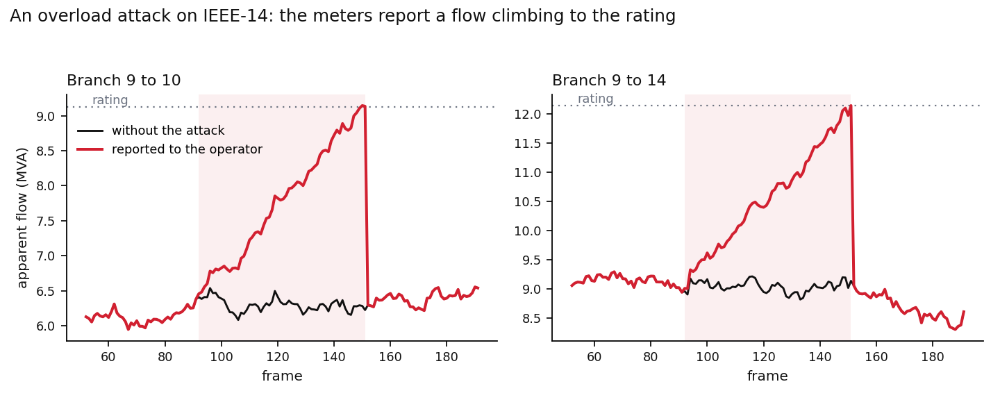
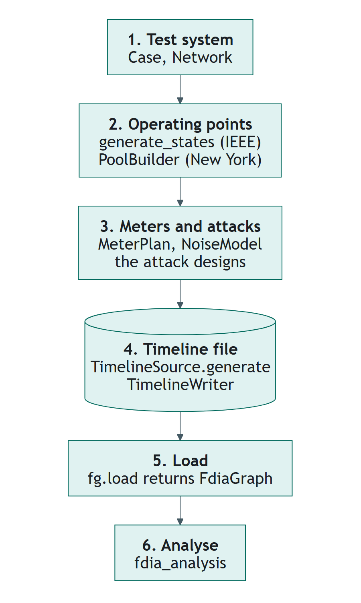

# fdia-graph

[](https://pypi.org/project/fdia-graph/)
[](https://pypi.org/project/fdia-graph/)
[](https://github.com/myersben9/fdia-graph/actions/workflows/smoke.yml)
[](LICENSE)

**Labelled cyber-attack data for power-grid research, and the code that makes it.**

`fdia-graph` builds timelines of meter readings on power-grid test systems, places false data
injection attacks (FDIA) in them, and labels every attacked bus. Each attack is solved on the AC
power-flow equations of the grid. Download a ready timeline, or generate your own.



One overload attack on IEEE-14, as an operator would see it. Over 60 frames the flow meters of two
branches report a flow that climbs to the rating, while the flow without the attack stays level.
`python examples/first_look.py` makes this figure,
[fdia-graph in five cells](examples/demo.ipynb) is a notebook that builds it from nothing, and
[Follow one attack through the code](docs/guides/tour.md) explains every step behind it.

## Three steps

**1. Load** a released dataset.

```python
import fdia_graph as fg

# downloads the IEEE-118 timeline once, then caches it
train = fg.load("ieee118", split="train")
arrays = train.export()
print(arrays["node_x"].shape, arrays["y"].shape)
```

**2. Generate** your own, then load it by name.

```python
# needs fdia-graph[generate]
# downloads the IEEE-14 pool of solved operating points
# about five minutes on a laptop
fg.generate("ieee14", name="my_run", frames=2000)
mine = fg.load("my_run", split="train")
```

**3. Analyse** it with an estimator.

```python
# needs fdia-analysis[se]
from fdia_analysis.se.methods import WLS

test = fg.load("ieee118", split="test")
est = WLS().fit(train)
print(est.score(test))
```

## Two toolkits

| Toolkit | Package | What it does |
|---|---|---|
| `fdia-graph` | `fdia_graph` | generates a timeline and loads it |
| `fdia-analysis` | `fdia_analysis` | runs estimators and localizers on a timeline |

`fdia-analysis` holds state estimation, attack localization, federated training, trusted-meter
selection and a results store. It depends on `fdia-graph`. `fdia-graph` never imports it.

## Test systems

| System | Buses | Data |
|---|---|---|
| IEEE and other public cases | 14, 30, 57, 89, 118, 145, 200, 300 | released datasets, downloaded by `fg.load` |
| New York grid | 140 | case file in the package; you build the dataset |

Each released dataset is one timeline of 72,000 frames. The New York grid is a MATPOWER case file
with 140 buses and 227 branches. It goes through the same generator, and
[Build the operating points](docs/guides/operating_points.md) starts its dataset.

The generator makes two attack families: `At`, a slow load ramp, and `Am`, a line overload. The
released files hold seven families: five that the generator does not make (`Aq`, `Ad`, `As`, `Ar`,
`Al`), and an `Am` that drives no line to its limit.
[The attack families](docs/concepts/attacks.md) has the details.

## How it flows



## Install

| Command | Gives |
|---|---|
| `pip install fdia-graph` | the loader: opens a timeline, exports splits as numpy arrays |
| `pip install "fdia-graph[torch]"` | adds PyTorch: single records, batches and the DataLoader |
| `pip install "fdia-graph[generate]"` | adds pandapower, to generate timelines |
| `pip install "fdia-analysis[se]"` | the analysis toolkit with state estimation |

Every extra of both toolkits is listed in [Install and data versions](docs/guides/install.md).

## Where next

- Tutorials: [load a dataset](docs/getting-started/load.md),
  [generate a timeline](docs/getting-started/generate.md),
  [analyse a timeline](docs/getting-started/analyse.md)
- Guides: [generate a timeline](docs/guides/generation.md),
  [follow one attack through the code](docs/guides/tour.md),
  [build the operating points](docs/guides/operating_points.md),
  [add a design family or a test system](docs/guides/extending.md),
  [troubleshooting](docs/guides/troubleshooting.md)
- Concepts: [how the package flows](docs/concepts/flow.md),
  [the test systems](docs/concepts/test_systems.md), [solving](docs/concepts/solving.md),
  [meters and noise](docs/concepts/meters.md), [the attack families](docs/concepts/attacks.md),
  [layers and labels](docs/concepts/layers.md)
- [Data dictionary: what every array means](docs/reference/DATA_DICTIONARY.md)
- [Runnable baselines and dataset statistics](docs/reference/EXAMPLES.md)
- Analysis pages: [state estimation](docs/analysis/estimation/README.md),
  [localization](docs/analysis/localization/README.md),
  [trusted meters](docs/analysis/trust/README.md),
  [federated training](docs/analysis/federated/README.md)
- [Contributing: rules, pull requests, releases](CONTRIBUTING.md)

## Citation

- `Al` (released files) and the load bound of `Am`: Yuan, Li & Ren, *Modeling load redistribution
  attacks in power systems*, IEEE T-SG 2(2), 2011.
- `At`: Haghshenas, Hasnat & Naeini, *A Temporal GNN for Cyber Attack Detection and Localization
  in Smart Grids*, IEEE ISGT 2023.
- Measurement model: Zaman & Lin, *PING: Physics-Informed GNNs to Generalize FDIA Localization*,
  NAPS 2025.
- Meter noise: Asprou, Kyriakides & Albu, *Variable Weights in a WLS State Estimator*, IEEE T-IM
  63, 2014.
- Protocol: Boyaci et al., *Joint Detection and Localization of Stealth FDIA*, IEEE T-SG, 2022.
- Local false states, `Am`, trusted meters: Wu, Wang, Hu, Ye & Tang, *Dynamic PMU configuration
  for stealthy multi-snapshot FDIA mitigation*, IEEE T-SG 17(1), 2026.

## License

Data under CC BY 4.0, code under MIT (see `LICENSE`). Synthetic, from public IEEE cases. Not for
operational decisions.
