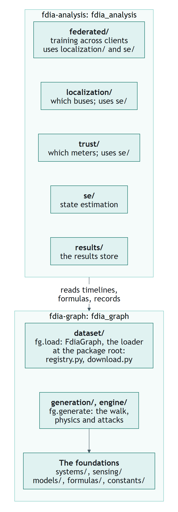
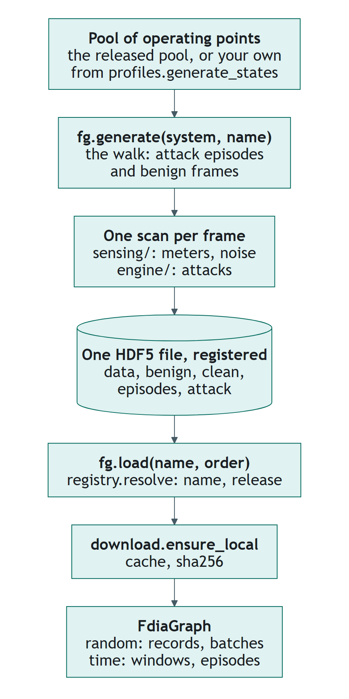

# Repo roadmap

Two halves. The **SDK** loads and serves data and runs on the base install; the **engine** is the
theory (power flow, meters, attacks) and needs `[generate]`. The public surface is `fg.*`, the
analysis packages `fdia_graph.se`, `fdia_graph.localization`, `fdia_graph.trust` and
`fdia_graph.federated`, and the New York grid (`fdia_graph.generation.nygrid` and its operator,
`fdia_graph.operator`, behind `[ny]`); everything else serves them.

## The two paths

## Files

Every package has one page that says what each of its files does, and `tools/layout.py` checks that the page
names them all. The one-line summary of every file of the repository is
[`reference/MODULES.md`](reference/MODULES.md), generated from the docstrings.

| file or folder | what it is |
|---|---|
| `__init__.py` | the public API; the heavy helpers resolve lazily so `load()` never imports torch or pandapower |
| `_lazy.py` | the public names of the New York packages, loaded on first use |
| `errors.py` | every error the package raises on purpose |
| `registry.py`, `download.py` | `(name, release)` to a download spec with that release's file layout; fetch to `~/.cache/fdia_graph`, sha256-verified |
| `schema.py` | the file protocol: every HDF5 group, dataset and attribute name, defined once |
| `timeline.py` | one continuous attacked timeline per system, written as one HDF5 file through the stages of `generation/` |
| `profiles.py` | ISO load profiles to AC operating-state pools |
| `streams.py` | the deprecated stream entry points, kept for reading the v0.7 stream files |
| `dataset/` | `FdiaGraph`, composed of `graph.py` (the static graph), `physics.py` (admittances, clean flows), `records.py` (items, collate, DataLoader), `export.py` (whole-split arrays) and `sequence.py` (windows, episodes) over `dataset/base.py` (shared state); `clients.py` reads a New York timeline as federated clients |
| `models/` | every value bundle the package passes or returns, one module per subject: `models/base.py` (`Bundle`), `fields.py` (the field groups bundles share), `grid.py`, `frames.py`, `data.py`, `scores.py`, `results.py`, `training.py`, `federated.py`, `assets.py`; the settings in `config.py` and the parser inputs in `inputs.py`, checked by `validation.py`; the fixed-set arguments in `choices.py` and the data-condition errors in `models/errors.py`. [`reference/DATA_DICTIONARY.md`](reference/DATA_DICTIONARY.md) lists every field |
| `ratings/` | PGLib-OPF branch ratings of IEEE-14, 118 and 300 |
| `formulas/` | the mathematics as pure functions with source keys: [`reference/FORMULAS.md`](reference/FORMULAS.md) |
| `engine/`, `generation/` | the generator: the AC physics, the meters and the attacks, and the stages that walk a timeline: [`guides/generation.md`](guides/generation.md) |
| `generation/nygrid/`, `operator/`, `engine/sensing/`, `se/detect/` | the New York grid, its operator, its meters and the operator's detector: [`nygrid/ARCHITECTURE.md`](nygrid/ARCHITECTURE.md) |
| `se/`, `localization/`, `trust/`, `federated/` | the analysis packages, each with its page: [`se/README.md`](se/README.md), [`localization/README.md`](localization/README.md), [`trust/README.md`](trust/README.md), [`federated/README.md`](federated/README.md) |
| `results/` | the results store's code: [`../results/README.md`](../results/README.md) |

## Docs

| folder | holds |
|---|---|
| `reference/` | the file map (`MODULES.md`), data dictionary, glossary, concepts to code, formulas, examples, benchmarks |
| `guides/` | task walkthroughs: `generation.md` (how a timeline is built), `state_estimation.md`, `new_york.md` |
| `nygrid/` | the New York grid: its architecture, a walkthrough, how to extend it, troubleshooting |
| `se/`, `localization/`, `trust/`, `federated/` | `run.py` fits one system and writes runs to the results store (`results/`); `make_report.py` (where present) draws the figures from it and `tools/results_docs.py` fills the README tables |
| `wu26/` | the reproduction of [WU26]'s defense results, written by the `tools/reproduce_*.py` scripts |
| `figures/` | shared images with their data sidecars |
| `plans/` | the design documents behind the 0.16 and 0.17 refactors (history, not instructions) |

## Tests and releases

| | |
|---|---|
| `python tools/review_ledger.py <num>` | records the automated reviewer's findings per pull request in `docs/reference/review_ledger.csv` and prints the tally by kind, so a recurring kind becomes a check |
| `python tools/prereview.py` | every CI gate, the test suite and the checks CI does not run, on this checkout's source; run before a review is requested (`docs/reference/REVIEW_CHECKLIST.md`) |
| `pytest tests` | builds a tiny IEEE-14 timeline in a throwaway cache (about a minute) and checks the documented contracts |
| `FDIA_SLOW=1 pytest tests` | adds a sanity test on the published IEEE-118 file |
| CI | tests on Linux (3.12 and 3.9) and Windows, pyright, ruff format and check, the readability gate, the layout gate (`tools/layout.py`: names, docstrings, package pages, cited names, the file map), the generated-docs checks, install on 3.9 and 3.12 |
| release | bump PR, then `python tools/release.py vX.Y.Z notes.md` (tag, GitHub release, PyPI); see `CONTRIBUTING.md` |

## Reading order

| step | read | to learn |
|---|---|---|
| 0 | `CONTRIBUTING.md` | the rules and the pull-request flow |
| 1 | `README.md` | install and quickstart |
| 2 | `guides/generation.md` | how a timeline is generated, and which layers a feature may read |
| 3 | `reference/GLOSSARY.md` | every term, with where it lives in the code |
| 4 | `reference/DATA_DICTIONARY.md` | every array and shape |
| 5 | this page, then `reference/MODULES.md` | which file does what |
| 6 | `reference/CONCEPTS_TO_CODE.md` | paper formulas to code |
| 7 | `reference/CLASS_MAP.md` | the class and module diagrams, drawn from the code by `tools/class_diagrams.py` |
| 8 | `reference/EXAMPLES.md` | training examples to copy from |
| 9 | `se/README.md`, `guides/state_estimation.md` | measurements in, better-than-WLS state out |
| 10 | `localization/README.md` | which buses are under attack, and why the slow ramp is open |
| 11 | `trust/README.md` | which meters to secure so a stealthy attack stops being stealthy |
| 12 | `federated/README.md` | the localizers and the prior trained across clients that never pool their records |
