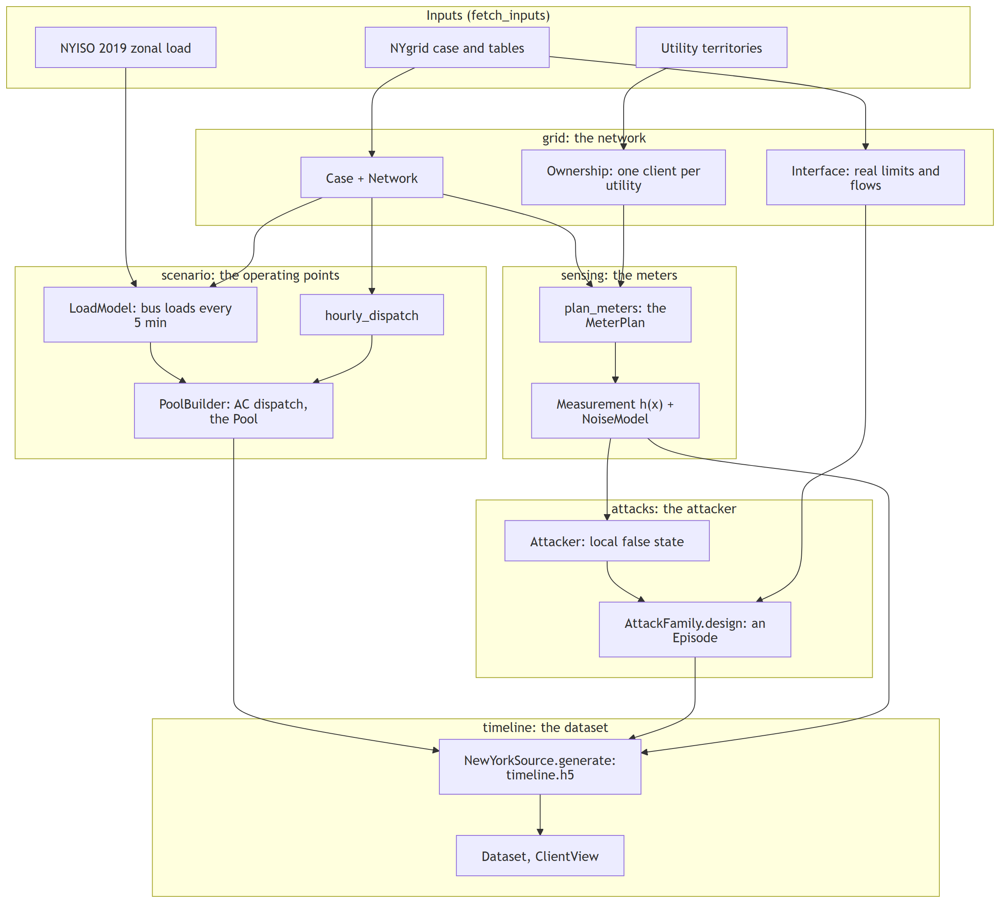

# Architecture

`fdia_graph.generation.nygrid` builds a federated FDIA dataset on the New York grid. It has been part of fdia-graph since 2026-11-02, its modules in the SDK's packages by job (the files below), its tests
`tests/nygrid/` (inputs under `NYGRID_ROOT`), its research tools `pipelines/newyork/`, its runnable extension examples
`examples/nygrid/`, and the results files `results/`.

Read alongside: [the walkthrough](../getting-started/new_york_walkthrough.md) follows one attack through every stage with the call that does each
step, [the extending guide](../guides/extending_new_york.md) says how to add an attack or an alarm rule, and
[the troubleshooting page](../guides/troubleshooting_new_york.md) what each stage reports when it fails. Tags N1 onward in the code
number the design decisions.

## How a run flows



Each box is a subpackage, one stage, and each stage reads what the one before it wrote. `grid` turns NYgrid's case into
the network and the clients; `scenario` solves the year of true operating points (the slow step, built once into the
pool); `sensing` places the meters; `attacks` designs each attack on a window of true states; `timeline` writes the
noisy, labelled year. Beside the stages, `se/detect` holds the alarm rules. Each package's `__init__.py` opens with what
its stage does.

## Principles

1. A setting is an argument of the function or constructor that uses it. Code never changes a library object's
   settings, or a shared record's arrays, after it is built: a variant is a copy (`with_overshoot`,
   `with_voltage_margin`).
2. Each package's `__init__.py` lists its public names (`__all__`), imported on first use, so reading a dataset never
   loads pandapower or Pyomo. A name outside `__all__` is internal and may change; a public name that is renamed is a
   changelog entry, with no alias kept.
3. A class owns state, cached work, or a shared interface. A plain function is stateless math. Data records are
   frozen dataclasses of numpy arrays.
4. Extension points are small: `AttackFamily` is the base class of the attack families, and
   `AlarmRule` is a protocol. The overload family is two classes: `OpfFdia` holds the
   support search and the per-scan OPF, and `InterfaceFdia` adds the goal and `design`, as their docstrings say.
5. One job per file. A file stays short enough to read in one sitting.
6. Dependencies point one way (below). pandapower lives in `generation/nygrid/solver.py`, h5py in `io.py`, random number
   creation in `config.py`. Pyomo models are built in `generation/nygrid/solver.py` and in the attack OPFs, and every one gets
   its Ipopt from `solvers.py`, which checks that it runs.
7. Measurements are one flat vector `z` per frame with a meter table beside it. A client's data is
   `z[:, meters.owner == c]`.
8. Failures are named: a wrong argument is a `ConfigError`, data that does not meet a condition a
   `DataConditionError`, a broken solver `SolverUnavailable`; what a stage cannot do it counts (`missed`)
   rather than hides.
9. The golden snapshots pin what the persistence rule and the interface attack return on fixed inputs,
   so a change that moves a number says so.

## Files

```
src/fdia_graph/
  generation/nygrid/
    __init__.py         the New York system's public names, loaded on first use
    config.py           Settings, rng()
    io.py               TimelineWriter, open_timeline, read_pool, write_pool, FAMILIES
    tables.py           read_rows (the input CSV tables, read whole and closed)
    case.py             Case (from_matpower, check), nygrid_case, ZONES, REGIONS (Region), FILE_AREA, NY_AREA, HQ_BUS
    network.py          Network
    case_nygrid.m       the New York grid, one MATPOWER case file (140 buses, 227 branches, 271 units)
    fixes.py            externals_at_base, hvdc_links
    interfaces.py       Interface, hourly_interfaces, NYISO_INTERFACES (N48)
    ny_bus_locations.csv each NY bus located on the territories (N12)
    inputs.py           ZoneLoad, NygridHour, read_nygrid, fetch_nyiso, download_once, fetch_inputs (every input at its pinned version)
    loads.py            LoadSeries, LoadModel (the bus profiles, with their within-hour terms)
    load_sources.py     the building-stock, EIA-861, census and IAC inputs the profiles come from, downloaded once
    dispatch.py         Dispatch, hourly_dispatch
    solver.py           AcSolver, Compensation
    pool.py             Pool, PoolBuilder, peak_ratings
    source.py           NewYorkSource (the grid as a timeline source; production() is the release's), SingleEpisodeSource, Survey
  engine/
    solvers.py          ipopt (the checked Ipopt every OPF runs on; SolverUnavailable when it cannot run)
  engine/sensing/
    __init__.py         what the stage does, and its public names
    meters.py           MeterPlan, plan_meters
    measure.py          Measurement
    noise.py            NoiseModel
  engine/attacks/
    family.py           Episode, AttackFamily (design, design_explained), the miss reasons
    attacker.py         Attacker, natural_steps, generator_ramps, generator_band, generator_q_capability, wrap_angles
    opf.py              OpfFdia (the base of the OPF attacks: the support search and the per-scan local AC OPF, N35)
    interface.py        InterfaceFdia (Am against a NYISO interface, N48, N49; overshoot and max_overshoot, N58)
    ramp.py             Ramp
  se/detect/
    __init__.py         what the stage does, and its public names
    rules.py            AlarmRule (protocol), PersistenceRule (k of the last n past a fitted threshold, N79)
  federated/
    utilities.py        Ownership, assign_clients
  dataset/
    clients.py          Dataset, ClientView
  _lazy.py            attach: the public names of a package, imported on first use
pipelines/newyork/
  build_timeline.py    the release timeline from a pool (--fetch downloads the inputs)
  make_case.py         the recipe of the case file and its writer: case_nygrid.m made again from NYgrid's Data/ folder
  build_single_episodes.py  one Am per file over its whole day, for studying one attack by hand
  matlab/nygrid/       MATLAB reference for NYgrid's AC feasibility (README inside)
  run_pool.py          builds the pool in parallel chunks (a week each, from its first hour's AC point), then repairs each seam by solving the next chunk's first frames again from the chunk before's last state until the thermal dispatch meets the stored one within 0.5 MW, so the year is one continuous dispatch; per-unit ramps from engine/attacks/attacker.py's constants, NYgrid's reactive limits (N38)
results/
  nygrid.ac_year.csv   per-hour MATLAB results over 2019, the scenario tests' reference
tests/nygrid/
  inputs.py      where the tests find their inputs, and which tests each input lets run
  test_{grid,scenario,sensing,attacks,timeline,dataset}.py
  test_{solvers,misses,tables,configs,detect,public}.py   checks that need no data
  test_golden.py, golden/   snapshots of the persistence rule and the interface attack
  data/matlab_ref/     operating points from dump_hours.m that the Python port must match
  data/days/           the pool's frames of two days, which the timeline digests build on (README inside)
```

`tools/`, `results/` and `tests/data/` follow the fdia_graph_sdk layout, so the move into the SDK
copies them as they are.

## How the pieces talk

The stages are drawn under "How a run flows" above. The imports point one way:

- `grid` imports only `config`.
- `scenario` and `sensing` import `grid`.
- `attacks` imports `grid` and `sensing`. Its local re-solve (the subnetwork Newton of [1] for a load goal, one
  least-squares solve since N18 holds the edge's non-free injections) is `Attacker._goal_solve` in
  `engine/attacks/attacker.py`, over `formulas.network.local_flow_solve`, pure numpy so `attacks` never imports
  pandapower; it is not a `Network` method
  (A1 decision). A family's `design` takes `window`, the tuple `(onset, vm [L, N],
  va [L, N])` of the frames it covers. The attacker's subnetwork may span utilities, and stealth is
  global: the attack vector is written on every meter it moves beyond noise, whoever owns it, so the
  operator's one residual test over all meters reads one AC state; `Episode.clients` records the
  owners of those meters, one or several.
- `timeline` imports everything above it and `io`.
- `detect` imports nothing of the package: a rule reads a statistic per scan.
- `dataset` imports only `io` and `generation/nygrid/network.py`, so loading data never needs pandapower.

## Records

Frozen dataclasses of arrays, passed between classes.

| record | file | fields |
|---|---|---|
| `Case` | `generation/nygrid/case.py` | `base_mva`, buses (`bus_id`, `zone`, `area`, `kv`, `vmin`, `vmax`, `lat`, `lon`, `is_ny`), branches (`f`, `t`, `r`, `x`, `b`, `tap`, `shift`, `rating`), units (`bus`, `fuel`, `pmin`, `pmax`, `qmin`, `qmax`, `ramp` MW/min, NaN where unknown), HVDC links (`f`, `t`, `pmin`, `pmax`), base state |
| `Ownership` | `federated/utilities.py` | `names [K]` (the 7 utilities), `bus_client [N]` (-1 for external buses), `tie_lines [L]` |
| `LoadSeries` | `generation/nygrid/loads.py` | `time [T]`, `p [T, N]`, `q [T, N]` |
| `NygridHour` | `generation/nygrid/inputs.py` | one hour of NYgrid inputs: `time`, `fuel_mw [7]`, `iface_flow`, `iface_pos`, `iface_neg [17]`, `nuclear_mw [6]`, `stl_cf`, `thermal_mw [227]`, NYgrid's bus split `ny_pd`, `ny_qd [N]`, netted renewables `renew_mw [N]`, the thermal units' linear cost `thermal_cost [227]` ($/MWh, weekly fuel price times heat rate, allocateGen.m 'lm'), the proxy-bus LBMPs `ext_lbmp [4]` (NPX, O H, PJM, H Q) |
| `Dispatch` | `generation/nygrid/dispatch.py` | `hour [H]`, `unit_p [H, G]`, `unit_on [H, G]`, `hvdc_p [H, D]`, the bus loads they balance `pd`, `qd [H, N]`, and NYgrid's generation cost `unit_cost [H, G]` ($/MWh: thermal from `thermal_cost`, nuclear and hydro at NYgrid's fixed draws, external units at their area's proxy LBMP) |
| `Pool` | `generation/nygrid/pool.py` | `time [T]`, `vm [T, N]`, `va [T, N]`, `p [T, N]`, `q [T, N]`, `solve_kind [T]` (`SOLVED`, `FAILED`, `NO_HOUR`, `NO_LOAD`; unsolved frames keep their place with NaN state, branch flows are `Network.flows(vm, va)`), `unit_p [T, G]` each unit's real-time dispatch basepoint (N32; None for a pool written before N32) |
| `Compensation` | `generation/nygrid/solver.py` | reactive support for a sensitivity of the benign dispatch (the release has none): switched shunt banks `shunt_lo`, `shunt_hi [N]` (MVAr at 1 p.u., reactors negative), a generator voltage schedule `v_schedule [N]` (p.u., NaN unregulated) held at `v_weight` k$/h per p.u.^2, the banks' switching cost `shunt_cost` (k$/h per MVAr), unit reactive limits `q_lo`, `q_hi [G]` and the operating band `v_lo`, `v_hi [N]` (NaN keeps the case's limit); `band(case)`, `shunt_buses` |
| `MeterPlan` | `engine/sensing/meters.py` | one row per meter: `kind` (v, va, p, q, pf, qf, i, ia), `bus`, `branch`, `end`, `owner`, `sigma_rel`, `sigma_abs`, `bias` |
| `Episode` | `engine/attacks/family.py` | `family`, `clients` (owners of the tampered meters), `onset`, `length`, `buses`, `target_branch`, `a [length, M]` |
| `Slot` | `models/plan.py` | one placed episode, the same record on every grid: `onset` (frame), `family` (here the name, "Am" or "At"; the IEEE generator uses the code), `length` |

## Classes

| class | file | holds | methods |
|---|---|---|---|
| `Network` | `generation/nygrid/network.py` | a `Case`, its `Ybus`, `Yf`, `Yt` built once, the bus adjacency | `injections(vm, va)`, `flows(vm, va)`, `currents(vm, va)`, `neighbors(buses, hops)` |
| `LoadModel` | `generation/nygrid/loads.py` | built as `LoadModel(case, own, nygrid_data, locations, cache_dir)`: each NY load bus's utility sector mix, its five nearest county prototype pools at 15 minutes (`building_stock_ny_15min.npz`), the IAC plant curves | `profiles(zone_load, rng) -> LoadSeries` (15-minute shares, then each bus's AR(1) fluctuation and industrial switching pulses, rescaled to the zone, N31) |
| `AcSolver` | `generation/nygrid/solver.py` | built as `AcSolver(case, compensation=None)`: the `Network`, the Pyomo AC-OPF model (two objectives: deviation, and generation cost plus a quadratic penalty holding anchored units to a schedule; with a `Compensation` the dispatch also sets each bank and adds the voltage schedule's penalty and the banks' switching cost, and holds the operating band, while `project` stays NYgrid's), one pandapower net built from the `Case`, the last solved state for warm starts | `project(pd, qd, unit_p, unit_on, hvdc_p)` (hourly min-deviation AC-OPF as a Pyomo model solved by Ipopt), `dispatch(pd, qd, cost, p_lo, p_hi, q_lo, q_hi, unit_on, hvdc_p, init=None, anchor=None, anchor_weight=1000)` (one five-minute least-cost AC-OPF within per-unit P and Q bounds, started from `init` = the previous (unit_p, unit_q), units with a finite `anchor` (MW) held near it at `anchor_weight` $/MW^2h, N32, N39; returns each bank's output `shunt_q [N]`), `power_flow(pd, qd, unit_p, unit_on, unit_vm, hvdc_p, start=None)` (pandapower, at a frame's basepoints; `start` = (vm, va) starts Newton at the dispatch's own solution) |
| `PoolBuilder` | `generation/nygrid/pool.py` | built as `PoolBuilder(solver, loads, dispatch, renew, ramp, q_cap=None)`: an `AcSolver`, the 5-minute `LoadSeries`, the `Dispatch`, NYgrid's hourly netted renewables `renew [H, N]`, each unit's ramp `ramp [G]` (MW per frame, inf unbounded), its reactive cap `q_cap [G]` (None: the case's limits, as the grid uses, N38; the solver's `Compensation` limits when it has one, the banks' output entering the power flow as a reactive injection); after a build `final` = (unit_p, unit_q, vm, va) of its last solved frame and per frame `slack_mw`, `cost`, `ramp_bound`, `anchor_dev`, `shunt_q [T, N]` | `build(start=None) -> Pool` (projects every hour the frames touch, then a least-cost AC-OPF per frame in order from `start` or from the first hour's AC point: thermal units within their limits and their ramp of the previous frame's basepoint, nuclear at the hourly AC points' output interpolated, hydro and external units anchored to it (N39), every unit in service for reactive power as in NYgrid's case; then a power flow at the basepoints), `report()` (solve counts, voltages, reference bus residual, cost, anchor deviation, ramp-held share, reactive fallbacks) |
| `Measurement` | `engine/sensing/measure.py` | a `Network`, a `MeterPlan` | `h(vm, va) -> z`, `jacobian(vm, va)`, `for_client(c)` |
| `NoiseModel` | `engine/sensing/noise.py` | the accuracy classes, the per-meter biases | `sigmas(z)`, `sample(z, rng)` |
| `AttackFamily` | `engine/attacks/family.py` | interface only | `design(window, rng) -> Episode` |
| `Attacker` | `engine/attacks/attacker.py` | a `Network`, a `Measurement` | `area(center, hops)` (the local subnetwork of [WU26], which may span utilities, or `None`), `false_state(vm, va, area, load_change)` (At's load goal: the pretended loads prescribed, solved by `formulas.network.local_flow_solve`: the area first grows over its non-free New York edge buses (`absorb`, N25); the other free injections of the area and its edge absorb, every other New York bus there, zero-injection ones included, holds its injection, a bus outside New York on the edge absorbs unless it has no unit and no injection (`_held_bus`, N44, bus 140), which holds; absorbing loads capped at 0.5 of their true P and Q (`ABSORB_CAP`, D16, N24); an active set pins a free injection at a bound and releases it when the solve without the pin leaves it inside), `attack_vector(vm_t, va_t, vm_f, va_f)` (global, in full), `tampered(vm, va, a)` (the meters moved beyond noise, angle changes wrapped: eq. 12 count, labels, owners), `load_buses(vm, va, buses=None)`, `free_injection_buses(vm, va, buses)`, `boundary(interior)`, `sigma(z)`, `bus_load(vm, va)` |
| `OpfFdia` | `engine/attacks/opf.py` | an `Attacker`; `hops` (3), `load_cap` (0.1, N28), `budget` candidate supports per search, `family` ("Am"), `exit_scans` (N30), which needs `step_bound [24, N]` (`natural_steps` at load buses, `generator_ramps` at generator buses) and `frame_hour [T]` the clock hour of the frames onsets index; `gen_ramp [N]` (`generator_ramps`), `gen_band [N]` (`generator_band`, 3% of the upper limit, N33/N37), `q_lo`, `q_hi [N]` (`generator_q_capability`, widened to the unit's true Q, N34/N38), `q_ramp [N]` (unbounded by default, N37), `windows_solved` (3), `gen_output [T, N]` (the units' output at each bus, from the pool's `unit_p`; the generator bounds act on it and the load at the bus moves within the load cap, N42), `loads_only` (False; True pretends no generator bus, N43) | the base class of the OPF attacks, with no `design` of its own: the support search (`_candidates`, supports grown from the goal's end buses, smallest first), each candidate support tested by a one-scan AC OPF at the last rise scan with every static bound (`_static`), then solved scan by scan by Ipopt with the ramp, exit-step and band bounds (`_sequential`), each scan kept within reach of the static solution and of zero at the last scan |
| `InterfaceFdia` | `engine/attacks/interface.py` | `OpfFdia`'s settings plus `interfaces` (a list of `Interface`, built over the same frames as the pool) and `near` (0.9); `windows_solved` 6 | `onset_mask(vm, va, length)` (last rise scan in a real 2019 hour at `near` of some interface's limit, N48), `design(window, rng)`: the goal is the model's interface flow plus that hour's real headroom (N49); supports grow from one interface branch's ends at a time; each window is solved with the meter objective (the change beyond noise on every P and Q flow meter touching the interior and every interior voltage meter, added to the injection terms) and with `OpfFdia`'s objective where that fails; the fewest tampered meters over all anchors is kept, and an attack still tampering at the last scan does not exist |
| `Ramp` | `engine/attacks/ramp.py` | an `Attacker`, the ramp settings | `design(window, rng)` |
| `NewYorkSource` | `generation/nygrid/source.py` | the grid as a `generation.source.TimelineSource`, built as `NewYorkSource(pool, attacker, families, own, settings=NewYorkSettings(), build=Settings())`: the pool, the `Attacker` (with its `Measurement`; the `NoiseModel` is made from its meter plan), the families by name (`{"Am": InterfaceFdia, "At": Ramp}`), the `Ownership`, the timeline's settings (`NewYorkSettings` in `models/config.py`: `length` 16 or `{family: frames}`, `attacked_frac` 0.2, `split` 0.7/0.15/0.15, `split_by` "week" (N41) or "time", `workers` 1, `block` 2016, `verbose`, `survey` 0, `survey_cache`) and the build `Settings` (whose seed keys every draw: `place`, `noise`, and `design/{family}/{onset}` per episode, so the result does not depend on `workers`) | `source.generate(path)` writes the file by the one path of every timeline, `TimelineSource.generate` ([generation.md](../guides/generation.md#one-path-two-grids)), under a `.part` name until it is whole, so a failed run leaves no file; `summary() -> dict` then returns slots placed and episodes built per split and family, slots skipped for unsolved frames, the median design seconds per family, seconds. The source's steps of that path: `prepare` asks each family for its `onset_mask` and, with `survey` (frames, N42), designs every allowed onset of a waiting family whose window lies in one week, on that grid, each chunk of `SURVEY_CHUNK` designs saved under `survey_cache` when given so a stopped build resumes; what it finds is the `Survey` record (the masks, the designs to reuse, the onsets tried, the miss reasons); `cut_splits` cuts the splits with `split_weeks` on the frames some waiting family may start at, after a survey on the onsets with an attack in strata of `HIT_STRATUM` weeks (N46) (or three blocks in time order (`split_bounds`) with `split_by="time"`); the shared plan stage (`place_split`) places each split's episodes inside one contiguous run of its frames and, for a family with a mask, only where it allows; `design` designs each on its own window of true pool states (in `workers` spawned processes when above 1, `generation.design.DesignPool`), the survey's designs reused, and a window touching an unsolved frame, or one the family returns None for, stays benign; `walk(until)` writes the frames in time order, each frame once every week before it is planned, so the file is written in stretches whose ends do not change a value. Frames: `z_benign = NoiseModel.sample(h(x_true))`, `z = z_benign + a` on episode frames; `meter_tampered` is `Attacker.tampered`, `bus_attacked` is true where a tampered meter sits at the bus |
| `TimelineWriter` | `io.py` | an open HDF5 file, built as `TimelineWriter(path)` | `write_static(case, own, plan)`, `write_frames(t0, block)` (`block` a dict of the per-frame arrays of frames `t0..`, datasets grown as written), `write_episodes(episodes)`, `close()` |
| `Dataset` | `dataset/clients.py` | an open timeline file (`open_timeline`) with its `case`, `own`, `plan` | `clients`, `client(name, split=None) -> ClientView`, `operator(split=None) -> ClientView` (every meter and bus, the operator's full scan); `split` is "train", "val", "test" or None for all frames |
| `ClientView` | `dataset/clients.py` | one client's meter, bus and frame selection, read when made, no file handle: `buses [N_c]` (bus positions it owns), `frames` (the indices of the selected frames, exact for the interleaved week split) | `z [T, M_c]`, `labels [T, N_c]` (`bus_attacked` of its buses), `meters` (its `MeterPlan` rows), `node_features()` (`[T, N_c, 4]` metered \|V\|, angle, P, Q per owned bus, NaN where not metered), `temporal()` (`[T, M_c]` change from the previous selected frame, zero at the first and after a gap in the selection, angle readings wrapped to (-180, 180]; `z` stays raw) |

## The case file

The New York grid is one MATPOWER case file, `src/fdia_graph/generation/nygrid/case_nygrid.m`, shipped with the package the way the IEEE test cases ship with pandapower. `nygrid_case()` reads it, and every build, test and pipeline starts from that `Case`. A change to the grid is an edit to the file: no code patches the case on the way in.

`Case.from_matpower(path)` reads the file with matpowercaseframes, the reader pandapower uses for `.m` files, and takes every column by MATPOWER's own name (`BUS_I`, `PD`, `RATE_A`, `TAP`). Standard MATPOWER fields carry everything they can: the bus `zone` column says where each bus is, as a number (the table below), `mpc.bus_name` the bus names and `mpc.genfuel` the unit fuels. Two numeric fields are ours: `mpc.bus_latlon` (latitude and longitude in degrees) and `mpc.gen_ramp` (MW per minute, `NaN` where the source gives none). A branch with status 0 is left out, and a tap ratio of 0, MATPOWER's mark of a line, is 1.

The case file is one system, so it has one area: the bus `area` column is 1 on every row (`FILE_AREA`), and a file with another number there is refused. The region of a bus is its zone code. The reader, the recipe's writer and the legend in the file follow one table of the codes, their names and the area each gives, in `generation/nygrid/case.py` (`ZONES` and `REGIONS`). `generation/nygrid/dispatch.py` still tells the neighbors apart by the area numbers of `Case.area`.

| zone code in the file | where | `Case.zone` | `Case.area` |
|---|---|---|---|
| 1 to 11 | the NYISO load zones A to K | `A` to `K` | 2 (`NY_AREA`) |
| 12 | New England | `""` | 1 |
| 13 | Ontario | `""` | 4 |
| 14 | MISO | `""` | 5 |
| 15 | PJM | `""` | 6 |

`Case.area` is derived from the zone code on read. For the neighbors it keeps NYgrid's NPCC area numbers, the ones the code and every stored file use. New York is area 2 on every bus: NYgrid's case splits it into 2 (upstate) and 3 (downstate), the file does not, and nothing in the package reads the difference. A timeline file written from now on therefore stores `case/area` 2 where one written before stores 3, on the 10 downstate buses, and nothing else differs. Files written before are read as before.

A file whose parts disagree is refused with a `DataConditionError` that names the file and what is wrong. `Case.from_matpower` refuses, as it reads, a bus number that is not whole or is on two rows, a unit or branch on a bus the case does not have, a zone number outside 1 to 15 and an area other than 1. `Case.check(source)` then refuses a bus type other than 1, 2, 3 or not exactly one reference bus, and a name, coordinate, fuel or ramp list with the wrong number of rows. Two things the library would pass over without a word are refused as well: an indexed assignment such as `mpc.bus(1, 3) = 500;` and a field that is not one of the case's (the standard `mpc.gencost`, `mpc.gentype`, `mpc.areas` and `mpc.dclinecost` are passed over). To change the grid, edit rows in place, one row per line (`tests/nygrid/test_case_file.py` has one case per rule).

`pipelines/newyork/make_case.py` is the recipe of the file, outside the package: it makes the file again from NYgrid's `Data/` folder (the NPCC-140 case at the pinned commit, NYgrid's own `modifyMPC.m` changes, the fixed unit list of its hourly case, zone J's units split over buses 81 and 82, and the 765 kV line 47-43), and holds the writer. Every number is written with the digits that read back to the same bits, and a test checks that the recipe still reproduces the checked-in file and its `Case` exactly. The recipe is where NYgrid's area numbers (1 New England, 2 and 3 New York, 4 Ontario, 5 MISO, 6 PJM) become the zone codes, and another test checks that each neighbor's buses and units are the ones its area number gives.

## Functions

Stateless steps, each called once in the build.

| function | file | in | out |
|---|---|---|---|
| `nygrid_case()` | `generation/nygrid/case.py` | the case file `case_nygrid.m`, shipped with the package | the `Case` every build starts from: 140 buses, 227 branches, 271 units |
| `Case.from_matpower(path)` | `generation/nygrid/case.py` | a MATPOWER case file | its `Case`, read with matpowercaseframes and checked: bus numbers become positions, the zone number a zone letter; a file whose parts disagree is a `DataConditionError` |
| `hvdc_links(case)` | `generation/nygrid/fixes.py` | `Case` | `Case` with NYgrid's four HVDC links as DC lines in place of the AC branch 81-125 (a variant; the release keeps the branch) |
| `externals_at_base(case, base)` | `generation/nygrid/fixes.py` | an hourly `Case`, the base `Case` | `Case` with external load at base and external units covering the balance |
| `hourly_interfaces(case, time, data, names=None, year=2019)` | `generation/nygrid/interfaces.py` | `Case`, the pool's frame times, NYgrid's data folder | a list of `Interface` (branches and signs from `updateOpCond.m` L420-430, real hourly limit and flow per frame from `interflowHourly_2019.csv`) |
| `peak_ratings(case, pool, factor=1.0)` | `generation/nygrid/pool.py` | `Case`, `Pool` | `Case` with each unrated branch at `factor` times its peak apparent flow over the solved frames (N8; 1.0 by N47) |
| `write_pool(path, pool)`, `read_pool(path)` | `io.py` | `Pool` | `pool.h5`: `time` (int64 seconds, NYISO local clock), `vm`, `va`, `p`, `q`, `solve_kind`, `unit_p` (when present) |
| `plan_meters(net, own, rng, vbus_frac=0.6)` | `engine/sensing/meters.py` | `Network`, `Ownership`, a generator | `MeterPlan`: P, Q at every NY bus, P, Q flow at every branch end on a NY bus, \|V\| at a random 60% of NY buses, PMUs (voltage and branch-current phasors) at the smallest set that sees every NY bus (N7), each meter owned by its bus's client, accuracy class and drawn bias per meter |
| `assign_clients(case, territories, locations)` | `federated/utilities.py` | `Case`, territory polygons, path to `data/territories/ny_bus_locations.csv` (substation location or zone-chosen utility per NY bus) | `Ownership`, one client per utility |
| `read_nygrid(data_dir, year)` | `generation/nygrid/inputs.py` | NYgrid `Data/` | `NygridHour` list |
| `fetch_nyiso(year)` | `generation/nygrid/inputs.py` | NYISO pal archive | `ZoneLoad` |
| `hourly_dispatch(case, hours, hold_externals=True)` | `generation/nygrid/dispatch.py` | | `Dispatch`; `hold_externals=False` keeps NYgrid's own external scaling (the AC ablation) |
| `split_weeks(time, frac, weight, rng, stratum=STRATUM)` | `generation/plan.py` | frame times, the shares, a weight per frame (the loaded onsets) | split column `[T]`: whole weeks ranked by weight, cut into strata of 20, each stratum drawn into train, val, test in the shares (N41) |
| `natural_steps(time, p, solved, pct=95.0)` | `engine/attacks/attacker.py` | the pool's frame times, net injections `p [T, N]` (MW), which frames are solved | `[24, N]` each bus's `pct` percentile of \|p(t) - p(t-1)\| over consecutive solved frames, by the clock hour of the later frame: the natural five-minute step the attacker knows, the bound on each scan of Am's exit (ours) |
| `place_episodes(rng, lengths, frac, n, allowed=None)` | `generation/plan.py` | one split's frame count, `{family: length}`, the attacked share, `{family: [T] allowed onsets}` | `Slot` list with the counts requested and dropped: the whole episodes closest to `frac T` frames, families equal in attacked frames (a family capped at what its allowed onsets hold), each at a uniform random onset among the allowed ones where it fits without overlap (adjacency and gaps come only from this) |
| `ipopt(**options)` | `solvers.py` | Ipopt's options | a Pyomo `SolverFactory` checked to start; `SolverUnavailable` with the fix when Pyomo or Ipopt is missing or Ipopt cannot start |
| `read_rows(path, encoding)` | `tables.py` | a CSV table of the inputs | its rows as dicts, the file closed |
| `open_timeline(path)` | `io.py` | `timeline.h5` | the read-only file with its `Case`, `Ownership`, `MeterPlan` (a file written before `Case.ramp` reads it as NaN) |
| `generator_ramps(case, minutes=5.0)` | `engine/attacks/attacker.py` | `Case` | `[N]` each bus's units' ramp over `minutes` (MW) summed at the bus: NYgrid's ramp, nuclear 0, hydro 10% of nameplate per minute, imports 300 MW per 15 minutes per unit (N34), inf at a bus with no unit |
| `generator_band(case, share=BASEPOINT_BAND)` | `engine/attacks/attacker.py` | `Case` | `[N]` `share` (3%) of each bus's units' upper limit (MW), the basepoint band (N33) |
| `generator_q_capability(case)` | `engine/attacks/attacker.py` | `Case` | `([N], [N])` reactive capability plus or minus 0.312 Pmax per bus (MVAr, N34) |
| `fetch_inputs(root)` | `generation/nygrid/inputs.py` | a folder | `root/data`: NYgrid's `Data/` at commit 47698b6, NYISO's pal archives for the year, the NYS DPS territories and the packaged `generation/nygrid/ny_bus_locations.csv`, each kept when already there (the load model fetches its own sources on the first pool build) |
| `NewYorkSource.production(pool_path, release=NewYorkRelease(), build=Settings())` | `generation/nygrid/source.py` | the pool and `fetch_inputs`'s folder | the release's `NewYorkSource`: peak ratings (N8), Am from the OPF attacker against the interfaces (N48, N49), At, every realism bound (N27 to N37, N42), 32-scan Am and 16-scan At windows, 20% attacked. What varies is a field of `NewYorkRelease` (`models/config.py`), checked when it is built: `families=("Am", "At")`, `interfaces=("SPR/DUN-SOUTH",)`, `workers=12`, `survey=12`, `survey_cache`, `root="."`, and the attacker's sensitivities: `hold_external` (N62), `v_margin` widens the voltage limits on the attacker's own copy of the case (N71), `gen_v_tol` holds generator voltages near their schedule (N75), `load_cap` replaces the OPF families' load cap (None keeps 0.1, N28), `band` the basepoint band's share (None keeps 0.03, N33). A family other than Am and At, or Am with no interface, is a `ConfigError` |
| `wrap_angles(d, kind)` | `engine/attacks/attacker.py` | reading differences `[..., M]`, meter kinds | the differences with angle readings (va, ia) wrapped to (-180, 180] |
| `InterfaceFdia.max_overshoot(window, rng, high=800.0, tol=25.0)` | `engine/attacks/interface.py` | a window | `(Episode or None, MW)`: the damaging variant at the largest overshoot past the limit the bounds allow, by bisection (N58), on a copy of the family |
| `InterfaceFdia.with_overshoot(mw)` | `engine/attacks/interface.py` | MW past the limit | a copy of the family with that goal; the original unchanged |
| `Case.with_voltage_margin(margin)` | `generation/nygrid/case.py` | p.u. | a copy with every bus's voltage limits widened (N71); the original unchanged |
| `SingleEpisodeSource(source, onset, family, lo, hi, using=None, lag=0)` | `generation/nygrid/source.py` | a `NewYorkSource` and one onset | the same grid with one episode alone over frames lo..hi, every frame in train: a subclass that gives the one slot in place of a random placement and whose design must exist; `.generate(path)` writes it by the same path; `using` designs it with a family variant (such as `with_overshoot`) in place of the source's own; `lag` (frames) designs it on the window `lag` frames earlier, the attacker's persistence forecast, and adds its vector to the true scans from `onset`; the one design runs in the caller's process |

## The timeline file

| group | dataset | shape |
|---|---|---|
| `case/` | the `Case` arrays (strings UTF-8 bytes), `bus_client`, `client_names`, `tie_lines` | static |
| `meters/` | the `MeterPlan` table, attribute `kind_codes` | `[M]` |
| `frames/` | `time` (int64 s), `split` (int8, attribute `split_codes`), `family` (int8, attribute `family_codes` benign, Am, At, Ap; nothing builds Ap any more, its code stays for files written with it), `episode` (int32 row, -1 benign) | `[T]` |
| `frames/` | `z` (observed), `z_benign`, float32 | `[T, M]` |
| `frames/` | `vm`, `va` (true state) | `[T, N]` |
| `labels/` | `bus_attacked` | `[T, N]` |
| `labels/` | `meter_tampered` | `[T, M]` |
| `episodes/` | one row per `Episode`: `family`, `onset`, `length`, `target_branch`; ragged `buses`, `clients` as flat arrays with `[S + 1]` offsets `buses_ptr`, `clients_ptr` | `[S]` |

`z - z_benign` is the attack. Temporal features are computed at load time from each client's own `z`.
Unsolved pool frames keep their place with NaN state and readings and no labels.

## Blocks to files

| block | files |
|---|---|
| F1, F2 | `pyproject.toml`, `config.py`, `io.py` |
| G1 | `generation/nygrid/case.py` (the case file and its reader), `generation/nygrid/network.py` |
| G2 | the case file (zone J's split and the 765 kV line are in it; `pipelines/newyork/make_case.py` is how), `generation/nygrid/fixes.py` (the variants) |
| G3 | the case file (the unit list, `mpc.gen` with `mpc.genfuel` and `mpc.gen_ramp`) |
| G4 | the case file (the tie ratings, `mpc.branch`), `peak_ratings` in `generation/nygrid/pool.py` |
| G5 | `federated/utilities.py`, `data/territories/ny_bus_locations.csv` |
| P1 | `generation/nygrid/inputs.py` |
| P2 | `generation/nygrid/loads.py` |
| P3 | `generation/nygrid/dispatch.py` |
| P4, P5 | `generation/nygrid/solver.py`, `generation/nygrid/pool.py` |
| M1 | `engine/sensing/meters.py` |
| M2 | `engine/sensing/measure.py`, `engine/sensing/noise.py` |
| A1 | `engine/attacks/family.py`, `engine/attacks/attacker.py` |
| A2 | `engine/attacks/opf.py`, `engine/attacks/interface.py` and `generation/nygrid/interfaces.py` (N48, N49) |
| A3 | `engine/attacks/ramp.py` |
| A4 | `natural_steps`, `generator_ramps`, `wrap_angles` in `engine/attacks/attacker.py`, `Case.ramp` from the case file (`mpc.gen_ramp`) |
| D1 | `generation/source.py` (`TimelineSource.generate`, the one path), `generation/plan.py`, `generation/nygrid/source.py`, `TimelineWriter` in `io.py` |
| D2 | `dataset/clients.py`, `open_timeline` in `io.py` |
| D3 | `fetch_inputs` in `inputs.py`, `NewYorkSource.production` in `source.py`, `pipelines/newyork/build_timeline.py`, `pipelines/newyork/build_single_episodes.py` |
