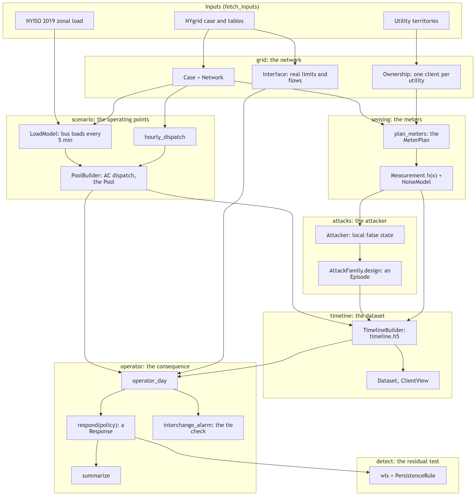

# The New York grid: one run, end to end

This page follows one attack through every stage of `fdia_graph.generation.nygrid`, from the network to the operator's alarm,
with the call that does each step. [The architecture](ARCHITECTURE.md) says how the modules fit together,
[the troubleshooting page](TROUBLESHOOTING.md) what each stage reports when it fails, and
[the extending guide](EXTENDING.md) how to add an attack, a detector or an operator of your own.



The snippets run from a work folder that holds the inputs (`python tools/nyfed/build_timeline.py --fetch`, see
[the guide](../guides/new_york.md)) and the 2019 pool (`tools/nyfed/run_pool.py`, several hours).

## 1. The network and the clients

`grid` turns NYgrid's case into a `Case`, a frozen record of arrays, and its admittances into a `Network`. Each New
York bus belongs to one utility, a client of the federated dataset.

```python
from fdia_graph.generation.nygrid import Network, modify_mpc, nygrid_units, read_npcc, restore_765kv, split_zone_j

data = "data/NYgrid/Data"
case = restore_765kv(split_zone_j(nygrid_units(modify_mpc(read_npcc(f"{data}/npcc.mat")), data)))
net = Network(case)
```

Each step returns a new `Case`; none changes one in place.

## 2. The operating points

`scenario` gives the true AC state of every five-minute frame of 2019: the loads by bus (`LoadModel`), NYgrid's
hourly dispatch, and a ramp-limited least-cost AC dispatch solved frame by frame (`PoolBuilder`). The year takes
hours, so it is built once and read back:

```python
from fdia_graph.generation.nygrid import read_pool
from fdia_graph.generation.nygrid import SOLVED

pool = read_pool("out/pool_2019_v3.h5")
print((pool.solve_kind == SOLVED).mean())  # 0.998: the frames that solved; only these are used downstream
```

## 3. The meters, the attacker and the timeline

`production_builder` assembles the release build: the clients, the meter plan, the attacker and its families, over
the pool. One attack window can be built on its own, which is how the studies of the paper are made:

```python
from fdia_graph.generation.nygrid import production_builder

b = production_builder("out/pool_2019_v3.h5", ("Am",), workers=1, survey=0)
b.build_episode("one.h5", onset=48220, family="Am")  # the interface attack at the limit, on its day
```

The Am family (`InterfaceFdia`) raises the reported flow of the Sprain Brook and Dunwoodie South interface to its
limit while keeping every reading consistent with a false state, so the operator's residual test cannot see it.
`b.build(path)` writes the whole year instead, with episodes placed at random; its summary counts what it placed,
built and, by reason, missed.

## 4. The clients' view

A client reads only its own meters, and the labels of its own buses:

```python
from fdia_graph.generation.nygrid import Dataset

ds = Dataset("one.h5")
view = ds.client(ds.clients[0])
print(view.z.shape, view.labels.shape)  # scans x this client's meters, scans x its buses
```

## 5. The operator's response

`operator_day` reads the attacked day with its benign twin; `respond` runs the operator on both, under an
`OperatorPolicy`; `summarize` gives the attack's consequence, attacked less benign:

```python
from fdia_graph.operator import OperatorPolicy, operator_day, respond, summarize

day = operator_day("one.h5", "out/pool_2019_v3.h5", "data/NYgrid/Data")
r = respond(day, policy=OperatorPolicy(mode="trusting", closed_loop=True))
s = summarize(r)
print(s["dispatch_moved_mw"], s["inadvertent_mwh"], s["pf_failed_scans"])
```

The trusting operator follows the attack's false load while its control error, read from the same falsified tie
meters, hides the shortfall: the neighbours supply it as inadvertent interchange. `r.alarm` is the scan the
interchange check against the neighbours' meters fires on (`interchange_alarm`).

## 6. The residual test after the operator acts

The attack was designed on the benign states; once the operator has moved generation, the true state is another
one, and the same attack vector no longer fits a state:

```python
from fdia_graph.generation.nygrid.attacks import wrap_angles
from fdia_graph.se.detect import PersistenceRule, reference_bus, wls
from fdia_graph.operator import TrueGrid, entry_share
from fdia_graph.generation.nygrid import Network
from fdia_graph.engine.sensing import Measurement, NoiseModel

meas, noise = Measurement(Network(day.case), day.plan), NoiseModel(day.plan)
grid, share, ref = TrueGrid(day), entry_share(day.case, "capacity"), reference_bus(day.case)
j = []
for t in range(day.onset, day.onset + day.length):
    x = grid.run_state(r.attacked, t, share)  # the true state once the operator has acted
    e = wrap_angles(day.z_benign[t] - meas.h(day.vm[t], day.va[t]), day.plan.kind)  # this scan's meter noise
    z = meas.h(*x) + (day.z[t] - day.z_benign[t]) + e
    j.append(wls(meas, z, noise.sigmas(day.z_benign[t]), *x, ref).j)
print(PersistenceRule(428.7).first_alarm(j))  # the first scan the residual test alarms on, -1 for none
```

`PersistenceRule.fit` calibrates the threshold on benign days.
