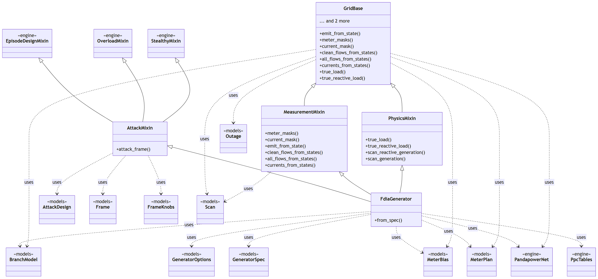
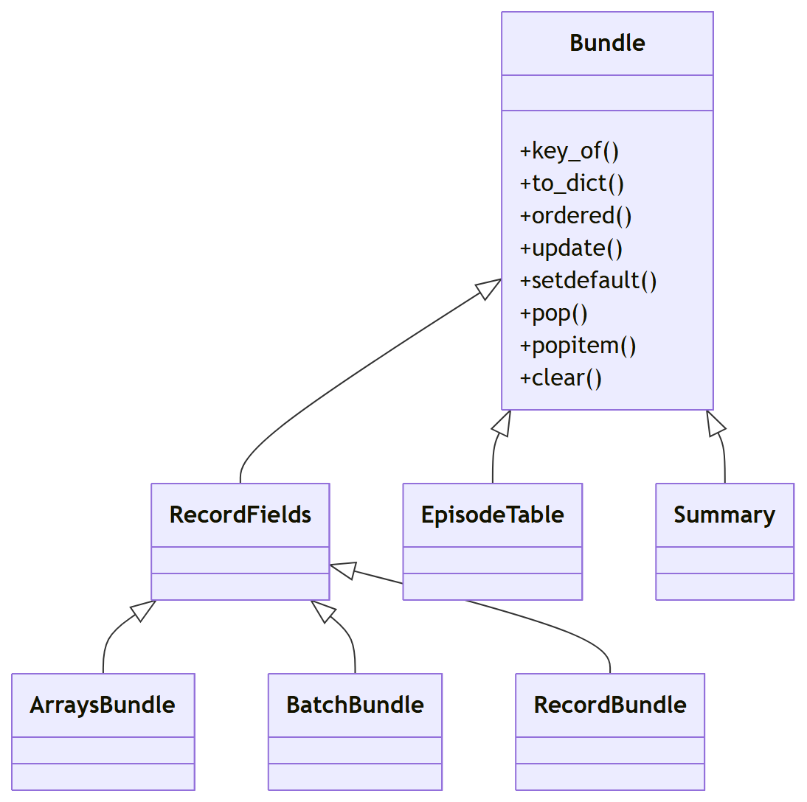
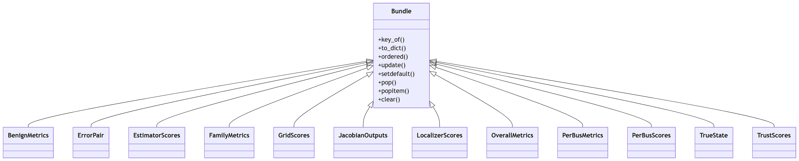

# Class map

How the pieces of the two toolkits connect, the generation toolkit `fdia_graph` and the analysis
toolkit `fdia_analysis`: one module diagram of both and eight class diagrams, all drawn from
the source by `tools/class_diagrams.py` (the AST gives each class's public methods, its bases and the
classes of other modules it names), so they cannot drift from the code. CI checks that the committed
sources match; `python tools/class_diagrams.py` rewrites them and `tools/render_mermaid.py` renders.
Read with [`MODULES.md`](MODULES.md) (what each file is for) and
[`CONCEPTS_TO_CODE.md`](CONCEPTS_TO_CODE.md) (which function implements which idea).

An open arrowhead is inheritance, a dashed arrow is a class using another (an argument type, a return
type or a collaborator it builds), and a box marked with another package's name is a participant that
lives there.

The diagrams are wide and are best viewed on a wide screen. Each picture links to its full-size file.

## Modules

Which module imports which, in one picture with a box per toolkit: every arrow between the boxes
runs from the analysis toolkit to the generation toolkit, never back. Five foundations are read by
nearly every module and are left out so the real dependencies show: each toolkit's `models/` (the
returned records and the settings; the one validation engine is `fdia_graph.models.validation`) and
`formulas/` (the equations), and the generation toolkit's `constants/` (the facts, each with its unit
and source), `schema.py` (the file protocol) and `errors.py` (the named errors). Each package's own `__init__.py` (for `fdia_graph`, the `fg.*`
public API, which imports everything) is left out for the same reason.

[![Module diagram in two boxes. The analysis toolkit, fdia_analysis: federated over localization and se; localization over se; trust over se; results beside them. The generation toolkit, fdia_graph: generation over data, engine, sensing, systems, timeline, download and registry; engine over data, sensing, systems and ratings; data over systems; sensing over systems; dataset over sensing and systems; timeline over generation; download over registry. Between the boxes every arrow points from analysis to generation: federated, localization, se and trust read dataset; trust reads generation and registry](../figures/diagrams/modules.png)](../figures/diagrams/modules.png)

## The dataset

`FdiaGraph` is the file. Five mixins over `DatasetBase` give it its faces: the static graph physics
(`GraphMixin`), the admittance matrices (`AdmittanceMixin`), records and batches (`RecordsMixin`), the
exports (`ExportMixin`) and the time-ordered windows and episodes (`SequenceMixin`). The methods that
produce records return `models` bundles (a record, a batch, an exported split, the episode table, the
summary); the graph properties are tensors or arrays, `loader()` is a DataLoader and `windows()` a tuple.

## The engine

`FdiaGenerator` is the AC model of one test system with its meter plan: the `Network` of its `Case` (an IEEE
case's is `Network.from_ieee`), a `MeterPlan`
(`MeterPlan.from_coverage`, or a plan given), a `Measurement` and a `NoiseModel`. It also holds one
object of each of its parts (`engine/base.py`, `Part`): a part does one job and holds the generator, so
it reads the grid as `self.g.case` and calls another part as `self.g.area.hop_area(...)`. `ScanLoads`
(`g.scan_loads`) reads a scan's load and generation and `Emitter` (`g.emitter`) emits scans; the parts of
`engine/attacks/` build every attack (next section). `Emitter.benign_frame` emits a benign scan, and a
designed episode (`engine/attacks/family.py`, `DesignedEpisode`) asks the parts for each attacked one;
`timeline.py` decides when and where each episode runs.

## The attacks

Every attack is built in `engine/attacks/`, one part of the generator per module:
`AttackArea` (`g.area`) finds the attacker's area, `FalseState` (`g.false_state`) solves and checks its false state, `AttackFrames`
(`g.attack_frames`) writes the attack vector onto the true scan, `RampFrames` (`g.ramp_frames`) builds the ramp frames, `Minimizer` (`g.minimizer`) finds the support that tampers
the fewest devices over an attack window [WU26, eq. 12] (`AttackWindow`, `window.py`, counts what a
support costs), `Overload` (`g.overload`) builds the overload `Am`,
and `EpisodeDesigns` (`g.episode_designs`) designs what an `At` or an `Am` episode attacks. `RampFrames.ramp_frame`
is the one entry for an attacked `At` scan; an `Am` frame comes from `overload_step`. The walk reaches
both through a designed episode (`engine/attacks/search.py`: `RampEpisode`, `OverloadEpisode`).

## State estimation

`SEBase` holds the shared solve: the measurement function, the chord Jacobian, the meter weights and the
chord-Newton loop. Each estimator overrides one hook. `GatedPrior` takes a fitted localizer as its gate;
`JacobianFeatures` is the per-bus feature block the localizers can consume.

## Localization and trusted meters

`LocalizerBase` calibrates any per-bus score to one false-alarm budget; the threshold arms score a stored
feature, `ResidualLocalizer` runs an estimator, the learned arms train a per-bus network.
`TrustSelector` chooses the meters to secure on the WLS Jacobian, by row reduction (`TrustedMeters`) or
by a deep Q-network (`TrustedMetersDQN`), and scores the residual test with them secured.

## Federated training

`FederatedLocalizer` is a `LearnedLocalizer` whose fit runs FedAvg over a `Partition` of the buses:
each client trains its own copy with the shared `LocalTrainer` on its own buses, and `FedBusMLP` and
`FedBusCNN` take their encoder from `BusMLP` and `BusCNN`. `RoundLog` records every round.
`RegionalPrior` is a `SubspacePrior` whose basis is fitted per client of a `Partition`.

## The records

Everything a call returns is a `Bundle`, a dict with attribute access and a fixed key order. The record
forms share one base, `RecordFields`, which declares every field once, so a record, a batch and an exported split
carry the same names. An exported split adds the export-only `prev_*` fields
(the previous frame's readings on a timeline).

## The scores

The result of every `score()` is a `Bundle` too, defined in the analysis toolkit
(`fdia_analysis.models.scores`) on the generation toolkit's `Bundle`: `ErrorPair` and `EstimatorScores` for the estimators,
`OverallMetrics`, `BenignMetrics`, `FamilyMetrics` and `LocalizerScores` for the localizers, `TrustScores`
for the trusted meters, `JacobianOutputs` for the feature block; `TrueState` (`fdia_analysis.models.data`)
is the truth an estimator is scored against.

The named tuples of `models/frames.py` (`Scan`, `Frame`, `OperatingLimits`, `FrameKnobs`),
`models/grid.py` (`BranchModel`, `Admittances`) and `models/assets.py` (`AssetSpec`) are plain
value types with no hierarchy, so they appear only where a class above uses them.
